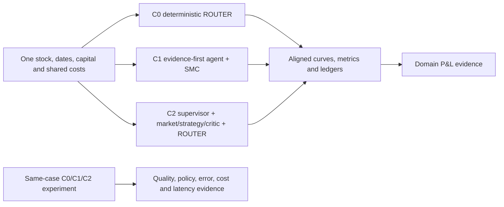

# AegisTrade AI 0.26: capstone evaluation and UI guide

13 November 2026

## What changed

The Strategy Backtests page now has **Start a new C1/C2 session**. It clears only the displayed selection; prior runs remain saved and can be opened deliberately. A saved paused run is no longer automatically selected after the user starts a new session.

Protective stop loss is optional. When disabled, the engine does not create an initial stop, does not apply a trailing stop and does not create stop-recovery entries. Position sizing uses cash and maximum-position exposure rather than a stop-distance risk budget. Take-profit, technical strategy exits, dated adverse-evidence exits, fees and slippage still apply. This setting can increase drawdown and capital tied up in open positions; it is an experiment variable, not an assumed improvement.

AI Agent Experiments now includes a coordinated **single-stock C0/C1/C2 portfolio comparison**. The user selects one stock, dates, capital, risk, stop choice, target, slippage, holding-review interval and inference allowance. The page shows status, aligned equity curves, final/partial metrics and a combined downloadable ledger.

## Three-flow comparison design

| Flow | Research and strategy | LLM use |
|---|---|---:|
| C0 | Deterministic technical ROUTER | Zero |
| C1 | One evidence-first tool-using agent, followed by SMC code checks | Bounded |
| C2 | Supervisor with market, strategy and critic specialists, followed by ROUTER code checks | Bounded |

C0 and C2 share ROUTER signals. C1 uses SMC. The three-way P&L view is therefore a **system comparison**, not a pure multi-agent ablation. The existing case experiment remains the academically fair E1 comparison: C0, C1 and C2 receive the same cases; C1/C2 use the same model, tools and call ceiling; outcomes include task success, policy violations, errors, calls and latency.

## Why C2 may not outperform technical-only returns

C2 is currently designed as a grounded safety and research layer. It may reject trades, enter later, hold cash, incur research failures or exit on adverse evidence. A technical baseline can outperform during a strong trend simply by taking more exposure. That does not prove C2 is useless, and a profitable C2 run would not prove the agents are better.

Do not tune C2 on the same historical period until it beats the baseline. That creates data leakage and overfitting. Improvements should target measurable failure categories on development cases: missing evidence, unsupported claims, false blocks, critic disagreement, tool errors and excessive cost. Freeze the design, then evaluate untouched held-out cases.

## Capstone minimum-bar evidence

The project already implements hybrid retrieval, typed MCP tools, C2 specialist orchestration, checkpointing, reviewed memory, a reflection workflow, exact-payload approval, security tests, FastAPI/Streamlit, Compose, CI definitions and monitoring definitions. The UI contains a minimum-bar evidence table with the corresponding demo location.

The following proof remains essential before the final claim:

1. Independently review at least 60 golden cases, with about 20 development and at least 40 protected held-out cases. Keep scenario variants in the same split.
2. Run E1 C0/C1/C2 with the same cases, model, tool access and budget. Repeat the final held-out comparison three times. Report task success, policy violations, errors/timeouts, cost, median latency and p95 latency.
3. Calibrate a genuinely different-family judge against at least 20 human labels and report Cohen's kappa and the confusion matrix.
4. Run E2 with defences off/on on at least 30 attacks and on clean cases. Report attack success and legitimate false blocks.
5. Run E3 memory off/on after reviewing lessons and freezing the playbook. Include one rejected lesson, total lesson-generation cost and any regression.
6. Retain one real replan trace, one stopped/resumed checkpoint trace and an edit-invalidates-approval demonstration.
7. Start Compose on a clean machine, demonstrate a firing alert and retain one intentionally failed hosted CI run.

The professor-approved three-person team exception should be retained with the contribution log because the supplied general guideline states four members.

## Recommended viva claim

“C2 did not consistently maximize historical return. Its intended improvement over C0 and C1 is evidence-grounded specialist separation, an independent critic, typed hand-offs, source traceability and fail-closed safety. We test whether those benefits justify their added latency and inference cost on a protected held-out set. Portfolio P&L is a secondary domain outcome and is reported with negative results.”

This claim is stronger than promising profit because it matches the project design and the evaluation rubric.

## UI demo steps

1. Refresh the dashboard and verify API version 0.26.0.
2. In Strategy Backtests, click **Start a new C2 session**, select dates and assumptions, choose whether to enable stop loss, provide consent and start the run. Open older runs only through Saved runs.
3. In AI Agent Experiments, expand **Capstone minimum-bar evidence and remaining proof**.
4. Run the case experiment with configuration ALL on preselected evaluation cases. Show the quality/reliability and cost/latency charts, then inspect the specialist hand-offs and tool traces.
5. In **Single-stock C0/C1/C2 portfolio comparison**, select a stock and a period with at least 45 sessions. Start with three to six months and an allowance appropriate to expected research cases; longer periods can require many calls and can pause at the budget boundary.
6. Refresh comparison progress. Show C0 immediately, then C1/C2 progress. When both finish, show the aligned equity chart, metrics and combined ledger. Download CSV and JSON.
7. Explain that a paused child can be opened and resumed from Strategy Backtests with explicit additional allowance. Never represent a partial curve as a full-period result.

## Stop-loss experiment

Run stop enabled and disabled as a controlled ablation with identical stock, dates, costs and agent configuration. Compare total return, maximum drawdown, exposure time, completed trades, worst open loss and gap losses. Choose the setting on development data and freeze it before held-out evaluation. Disabling stops should not be selected merely because one reviewed run recovers after a drawdown.
