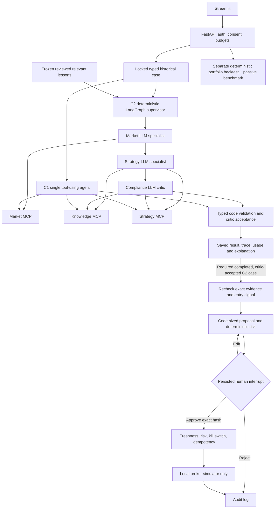

# Implemented architecture — 9 November 2026

C2 normally uses six model requests, with a shared maximum of eight. C1 has the same union of tools, model and budget ceiling. Local tools use actual stdio MCP; Docker uses HTTP MCP. No broker/write tool is offered to LLMs. The order graph is checkpointed in SQLite; research results are persisted JSON, without mid-call resume.

Local RAG is verified: 81 passages, BM25 + MiniLM vectors + RRF + cross-encoder reranking, persistent Chroma and source/date filtering. The TF-IDF baseline remains explicit; Qdrant/Docker deployment is still unverified. Full details and evidence boundaries are in the viva handbook and gap review.

C2 completion is mandatory before preparing any supervised order. Both start routes and resumed approvals revalidate saved research, typed specialist hand-offs, critic acceptance, citation evidence, a bound result digest and current market facts. There is no deterministic proposal bypass. Historical backtests are isolated calculations and remain model-free.

Active research data: a cached 20-stock NSEPython subset. A pre-period liquidity screen freezes the research universe; a point-in-time rule-based picker ranks each completed-session signal using capital and risk constraints. Automatic historical replay is approved at setup; selected candidates then enter the separate mandatory-C2 supervised workflow. Source/coverage, rankings, exclusions and provisional-data limits are visible in the UI.

C2 policy observations carry a corpus SHA-256 and source metadata. Route citations must include a project-policy passage; public background cannot authorize rules. External sources are filtered by the locked historical case date. Corpus changes invalidate an outstanding research-linked approval. See RAG_IMPLEMENTATION_GUIDE.md for actual development scores and remaining evaluation limits.

## Version 0.14 historical-company research update — 9 November 2026

C2 now requires dated company financial filings and issuer news through company_evidence on the existing market MCP. Market and critic independently observe the exact symbol/15:30 IST case pack. A qualifying financial-content citation and SUFFICIENT assessment are required before a proposal; missing/unreadable/future evidence fails closed. Company-pack changes invalidate research and pending approval. Normal generation remains six calls, with seven tool invocations; the shared eight-call ceiling and three specialists remain. The policy corpus is still81 passages; company packs are separate. Real TCS2026-10-23 evidence is cached; INFY is currently insufficient. No paid generation was made for this update. See HISTORICAL_COMPANY_RESEARCH.md and the current Detailed Design and Demo Guide for source bounds, reviewed news/newsletter imports and exact UI steps. Earlier policy-only descriptions are superseded by this section.

## Version 0.15 end-to-end C2 historical portfolio — 9 November 2026

The historical capability is now split explicitly: Technical-only baseline (zero generation) and C2 historical portfolio (dated C2 before prospective entries, scheduled HOLD/EXIT reviews, code risk/strategy exits and next-open accounting). Historical fills use upfront rule approval and a total paid-request allowance, with durable OPEN/CLOSE checkpoints and budget/provider pause/resume. The end date never forces a sale: open holdings retain last-known marks and unrealized P&L; final-close exit intentions remain unfilled. Separate supervised actions still require exact human approval.99 tests pass; actual NSE/MCP/neural integration was verified with explicitly mocked generation, not a paid profitability result. Current guide/viva use source0.15.0, six diagrams and80 questions. See C2_HISTORICAL_PORTFOLIO.md. Earlier descriptions that all historical replay is deterministic are superseded.
