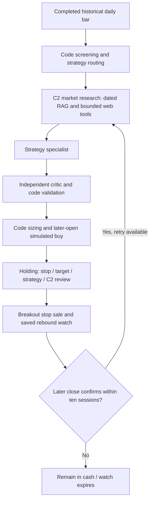

# AegisTrade AI: pullback strategy, breakout risk and stopped-setup re-entry

Version 0.23.0 · 12 November 2026

## What changed

Breakout remains available. EMA_PULLBACK adds a confirmed rebound within an established trend. Breakout has separate risk, initial-stop and trailing settings. After a breakout stop, the simulator can watch for one confirmed rebound and research a new entry. These are experimental rules, not optimized parameters or evidence of improved profitability. Existing saved runs and lessons are retained; start a new run to evaluate the changed rules.

## Strategy routing and signals

Code first excludes indicator warmup and high volatility. It then routes confirmed PULLBACK to EMA_PULLBACK, otherwise BREAKOUT to BREAKOUT, established TREND to EMA_TREND, and RANGE to RSI_REVERSION. Other cases abstain. This routing order intentionally gives the confirmed trend pullback priority where setups overlap. Breakout is retained for other qualifying breakouts.

| Strategy | Entry at completed close | Strategy exit |
| --- | --- | --- |
| EMA_TREND | Routed trend: ADX14 ≥22 and EMA20>EMA50; close>EMA20 | EMA20<EMA50 |
| EMA_PULLBACK | ADX14≥22, EMA20>EMA50; a bar within the preceding three sessions touched EMA20, closed at/above EMA50 and followed a prior close above EMA20; confirmation close exceeds EMA20 and previous-session high | EMA20<EMA50 |
| RSI_REVERSION | Routed range, RSI14<42 and close>0.88×EMA50 | RSI14>58 |
| BREAKOUT | Close above the previous 20-session high and ADX14≥18 | Close<EMA20 |

All holdings also have code stops, optional trailing, configured take-profit and validated C2 adverse/exit decisions. Strategy and C2 exits fill at a later eligible open. There is no forced sale at the period end. Technical-only fixed-strategy modes apply their entry rules independently of router choice, subject to screening exclusions.

## Breakout defaults and sizing

| Setting | Default |
| --- | --- |
| Breakout planned risk | 0.5% of current equity |
| Initial stop | Signal close minus 2.5×signal ATR14 |
| Alternate initial stop | User-selectable percentage below signal close; 5% displayed |
| Trailing distance | 2.5×ATR14 frozen at entry signal |
| Trailing activation | Highest completed close reaches entry fill plus 1×original risk per share |
| Re-entry | Enabled; one per stopped setup |
| Rebound watch | Ten subsequent portfolio trading sessions |

Other strategies retain their common settings (default risk 1%, initial 2×ATR and trailing 2×ATR). Global trailing enable/disable applies to every strategy. The initial stop is fixed before the later-open fill. The actual fill determines sizing and original risk R; quantity is constrained by cash, fees, position exposure and risk. A wider stop therefore reduces quantity. Gaps, slippage and fees can exceed the planned loss. The standalone supervised order workflow uses the default breakout 0.5% risk and 2.5×ATR stop; portfolio UI overrides apply to that portfolio only.

Example: signal close ₹100, ATR ₹2 gives initial breakout stop ₹95. If actual entry is ₹100, original R is ₹5. Trailing waits until a completed close reaches ₹105, then a 2.5×ATR trail can raise the stop to ₹100, effective next session. At ₹200,000 equity, 0.5% is ₹1,000 planned price risk; risk sizing at this example allows at most 200 shares, possibly fewer under other limits. This is an arithmetic illustration, not a trade recommendation.

## Stop, rebound and fresh research

1. A breakout stop is executed using the existing daily-bar gap rules: opening below stop fills at that open; otherwise a touched stop fills at the stop, with modeled slippage and fees. Daily bars cannot guarantee the real intraday execution path.
2. After the sale, persist the symbol, stop date/level, entry date, session index and retry count. The position is closed; no averaging down or doubling quantity occurs.
3. The stop session cannot re-enter, even if its close rebounds. During the next ten portfolio trading sessions, a later completed close must exceed the stopped level, EMA20 and previous-session high, with ADX14≥18 and no warmup/high-volatility exclusion. Other liquidity, discontinuity, ranking, capital, daily-loss and position limits still apply.
4. The overlay marks this candidate BREAKOUT_BOUNCE and routes it to BREAKOUT. It must rank into an available slot. In C2 mode, fresh market research, strategy research, independent critic and typed/code validation are required. A rebound alone cannot replace company evidence: the strict recent verbatim improvement/completed-commercial-event source quote and independent critic corroboration remain mandatory. Bounded dated web search is available under the existing policy. No qualifying evidence means no C2 re-entry.
5. A passing decision queues a later-open buy with newly computed stop and quantity under breakout risk. Friday/pre-gap signals still wait for fresh next-trading-close review, then a later open. An unfilled order does not consume the retry.
6. A successful rebound fill consumes the one retry. A second stop marks this setup EXHAUSTED. An observed cited adverse finding cancels its watch. Profit targets, strategy exits and C2 adverse exits do not create stop-rebound watches. On watch expiry, normal future setups may qualify again; the rule does not ban a stock permanently.

A rebound can fail and lose again. The bounded retry limits repeated losses; it does not make a stopped trade profitable. The ten-session window concerns confirmation, while queued execution follows later-open/gap rules. A long account/provider pause preserves simulated chronology and does not turn historical dates into live orders.

## Orchestration diagram

[[FIGURE:breakout_reentry]]

The technical reference shares execution/risk/re-entry arithmetic, but makes zero generation calls. The C2 portfolio repeats C2 research for rebound entry and can reject it. A new research case normally takes six inference units; up to eight are reserved. Re-entry can increase total run usage. Neither increasing total allowance nor enabling re-entry raises the normal per-case allowance.

## UI demo steps

1. Start the API and dashboard together from the repository with `bash scripts/start_unix.sh`. Open http://127.0.0.1:8501. Health should report version 0.23.0 and breakout_reentry_supported=true. Paste your private reviewer token in the sidebar; do not share it.
2. Retain the desired loaded universe in Market/Data. Check its downloaded dates and coverage. Five-year datasets need pre-period warmup. Raw-price structural actions and missing dated evidence can still block candidates.
3. Open Strategy Backtests. First choose Technical-only baseline and ALL for an inexpensive mechanics check. ALL now compares ROUTER plus four strategies. Use a short available period, e.g. 1 December 2023 to 29 February 2024 if loaded, ₹200,000 and normal modeled fees/slippage. These dates are an example, not a selected winning window.
4. Inspect both initial-stop selectors above the form. Keep breakout ATR, 0.5% risk, 2.5×ATR stop, 2.5×ATR trail, 1R activation and confirmed re-entry enabled. Other strategies retain their own controls. Set take-profit as desired before the run; preserve the same settings across comparisons. Approve replay assumptions and run.
5. Inspect ledger BUY/SELL_STOP/SELL_TRAILING_STOP, stop adjustments, and Strategy risk settings and breakout re-entry watch. A rebound BUY must have its own later signal/fill date. A run need not contain a stopped breakout or qualifying rebound; absence is not automatically a failure.
6. Choose C2 historical portfolio, the same capital, dates and settings. Begin with a short window and 48 inference units, holding review every five sessions, no lessons for the first controlled comparison. Authorize inference and replay rules. C2 can pause at budget/provider limits; retain refresh, inspect diagnostics and explicitly resume only after addressing the cause.
7. Inspect decisions for entry_setup BREAKOUT_BOUNCE and its research ID; load that research trace. Verify the new source quote, critic corroboration and temporal cutoff. The rebound BUY ledger has entry_setup BREAKOUT_BOUNCE and separate risk_percent_used. The technical reference may buy where C2 abstains. End holdings remain marked to market.
8. Compare returns, drawdown, fees, completed trades, blocked cases and open holdings over several disjoint periods. Use a held-out later period after fixing parameters. Do not tune a percentage against the same losing examples and claim a general improvement. This implementation has mocked-provider contract tests; no paid/ChatGPT generation or profitable historical outcome was verified during implementation.

## Viva questions and answers

**Why sell then re-enter?** The stop controls the current position's risk. A later rebound is a separate decision with new sizing, evidence and audit provenance. Holding through a violated stop would change the original risk contract.

**Why not rebuy immediately at the stop?** A daily candle cannot establish that a dip happened before its high. Requiring a later completed close and later-open execution prevents same-bar lookahead.

**Is a new 20-day high required for the rebound?** No. BREAKOUT_BOUNCE explicitly requires recovery above the stopped level, EMA20 and previous high with ADX≥18. It is an audited recovery variant within BREAKOUT; ordinary breakout retains the 20-session-high rule.

**Can the LLM skip evidence because price bounced?** No. Breakout and rebound entries use the same strict source-quote and critic gates. The confirmed trend-pullback strategy has the established trend policy for incomplete coverage, with unresolved adverse risk still blocking entry.

**Why 0.5% risk and 2.5 ATR?** They are conservative prototype defaults separating breakout risk from other strategies and allowing volatility room with smaller quantity. They are not statistically optimized or guaranteed suitable for every stock.

**How is memory used?** Saved portfolio state persists watches, fills, positions and processed research keys. Reviewed lesson memory remains separate and cannot override stop, evidence or retry limits. No model fine-tuning occurs.

**Can restart repeat a buy or research?** Checkpoints preserve queued orders and durable responses. A consumed retry is attached to the filled position. Existing idempotency and code/prompt/corpus fingerprints protect resume; old-version runs remain readable but need a fresh run for new rules.

**What still limits financial conclusions?** Raw/unadjusted prices, present/frozen constituents, bounded dated company/news coverage, daily-bar assumptions, modeled costs, selection bias and lack of independent out-of-sample profitability evidence.
