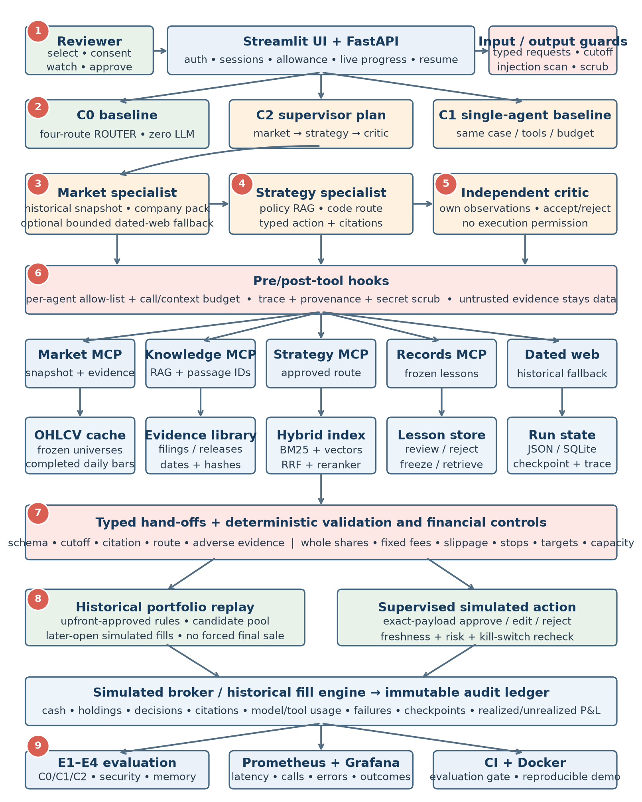
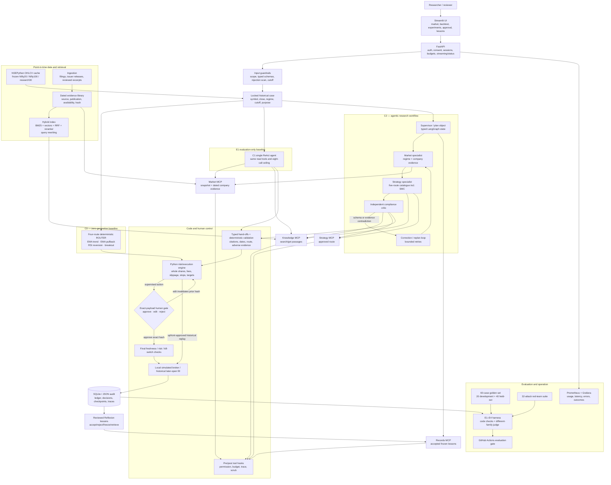

# AegisTrade AI v0.27 — final architecture and walkthrough

This is the original AegisTrade detailed-design diagram for final review. Its numbered layered presentation follows the capstone guideline's diagram convention, while every component and connection describes this repository. The system is simulation-only.

*Figure 1: AegisTrade AI detailed design. Numbers match the walkthrough below.*

## Numbered walkthrough

1. The reviewer selects a frozen universe, historical period, capital and risk policy in Streamlit.
2. FastAPI validates authentication, explicit inference consent and a bounded allowance. Historical replay receives upfront approval of deterministic rules; supervised actions use exact-payload approval later.
3. Code creates a locked case from completed daily bars. No future price or post-cutoff evidence is available.
4. C0 routes the case through four deterministic strategies and makes zero model calls. In the E1 experiment, C1 receives the same case, tools, model and budget as C2 but uses one agent.
5. C2 creates a plan and invokes market, strategy and critic specialists. Its catalogue adds SMC to the four C0 routes. Each specialist has scoped read tools.
6. Market/company tools return dated evidence. Hybrid policy retrieval combines BM25 and vectors with RRF, reranking and query rewriting. Every result retains source/date/passage IDs.
7. Typed hand-offs are validated. A contradiction causes a bounded correction/replan. Missing evidence is recorded honestly; it is never described as a positive fundamental finding. Breakouts require stricter corroboration.
8. Python—not the LLM—calculates ranking, quantity, fees, slippage, stops, profit targets and portfolio limits.
9. Supervised simulated actions pause for approve/edit/reject on the exact hashed payload; editing invalidates the old approval. Historical replay uses the separately approved replay policy and later-open fills.
10. Decisions, model/tool traces, checkpoints and ledger events are persisted. Interrupted portfolio jobs resume only when data, prompt, corpus, backend and engine versions still match.
11. Failed development cases can produce conditional Reflexion lessons. A human accepts or rejects each lesson and freezes a version before later-period evaluation.
12. The evaluation harness runs code-first checks, C0/C1/C2 comparisons, security trials, memory ablations and critic/retrieval ablations. Prometheus/Grafana and CI expose operational evidence.

## Decision ownership

| Decision | Owner |
|---|---|
| Technical indicator, route eligibility, score and SMC pattern | Tested Python code |
| Evidence interpretation and explanation | LLM specialist |
| Cross-checking the proposed interpretation | Independent LLM critic plus code validation |
| Quantity, fees, risk, stop, target and fill mechanics | Tested Python code |
| Exact supervised simulated action | Human reviewer |
| Historical replay fills | Code under upfront-approved replay rules |
| Live exchange order | Not implemented |

