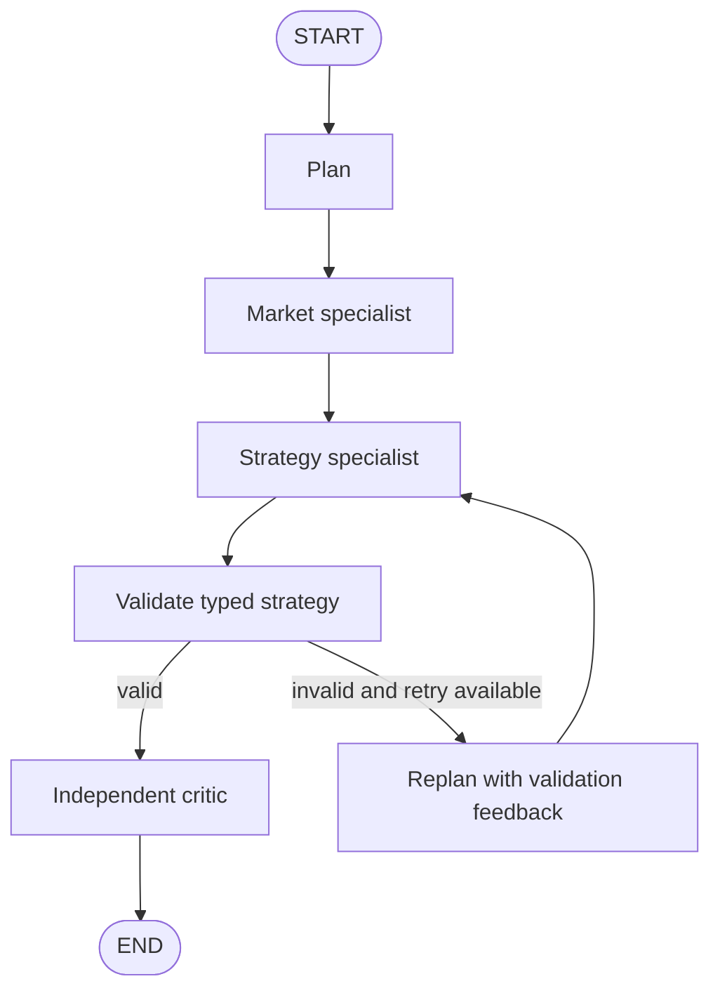
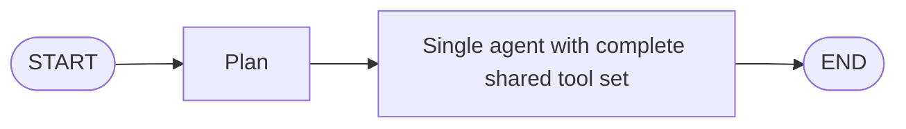
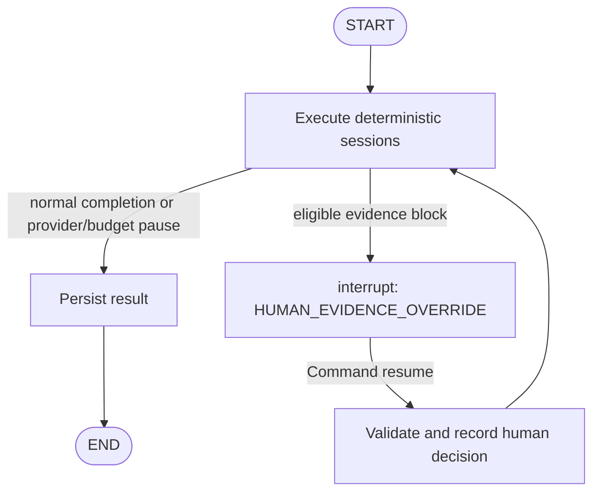

# AegisTrade LangGraph orchestration and resume guide

## Implemented scope

New C1/C2 AI Experiments and new C2 portfolio runs use LangGraph. Existing strategies, MCP tools, evidence validation, risk arithmetic and ledgers remain unchanged. Runs created before `portfolio-v11-langgraph-checkpoint-v1` remain viewable and are labelled `Legacy custom Python`; they are not rewritten or falsely presented as LangGraph runs.

## C2 research graph



Each specialist retains its bounded ReAct tool loop. The graph state is typed by `ResearchState`; specialist hand-offs remain Pydantic `MarketJudgement`, `StrategyJudgement` and `CriticJudgement`. The graph-level correction edge supplements field-level schema correction inside a specialist.

## C1 graph



C1 and C2 therefore use the same graph framework and persistent checkpoint service. C1 remains the same-model, same-case, same-tool-union, same-budget single-agent baseline.

## C2 portfolio graph



The outer graph does not perform financial arithmetic. `c2_portfolio.py` remains the tested source of prices, quantities, fees, stops, cash and ledgers. LangGraph owns orchestration transitions and durable thread state.

## Persistence

| State | Storage | Purpose |
|---|---|---|
| LangGraph node/checkpoint state | `data/langgraph/checkpoints.sqlite` | Stop/resume, node history and pending interrupts |
| Financial portfolio state | `data/c2_portfolio_runs/<run_id>/state.json` | Versioned cash, positions, ledger and compatibility |
| Per-case research trace | `data/c2_portfolio_runs/<run_id>/research/<case_id>.json` | Tool calls, hand-offs, citations, validation and usage |

Every new portfolio uses thread ID `portfolio:<run_id>`. Each portfolio research case uses `portfolio:<run_id>:<case_id>`. Standalone AI Experiment cases receive unique research thread IDs.

## Native approval contract

The human gate invokes LangGraph `interrupt()` with a bounded payload containing the override ID, symbol, proposed action, prices, evidence-block reason and research binding. The proposed order is deliberately excluded from the displayed interrupt payload. Resume uses:

```python
resume_portfolio_graph(
    run_id,
    frame,
    {
        "override_id": override_id,
        "decision": "APPROVE_OVERRIDE",  # or KEEP_BLOCKED
        "reviewer": "Karthika K",
        "rationale": "Evidence uncertainty accepted for this simulation study."
    },
)
```

Internally this is passed as `Command(resume=review)`. The deterministic application validates the exact pending override before queueing a simulated order. Protective stops and other code exits do not wait for an LLM or human interrupt.

## Final-review demonstration

1. Start a new short C2 portfolio run from Strategy Backtests.
2. Open the result and show `Orchestration: LangGraph`, graph name, SQLite checkpointer and thread ID.
3. Pause a run at a safe boundary and restart the application.
4. Reopen the saved run and resume it; show that completed financial sessions and research records are not duplicated.
5. Use a controlled eligible evidence-block case to display the pending `HUMAN_EVIDENCE_OVERRIDE` interrupt.
6. Record either `KEEP_BLOCKED` or `APPROVE_OVERRIDE` with reviewer and rationale.
7. Show the separate C2 decision, human ledger event and later outcome.
8. Display the generated graph sources:
   - `docs/diagrams/C2_RESEARCH_LANGGRAPH.mmd`
   - `docs/diagrams/C2_PORTFOLIO_LANGGRAPH.mmd`

## Verification

The contracts in `tests/test_langgraph_orchestration.py` verify that both executable graph diagrams contain the required nodes and that a new C2 portfolio writes a non-empty SQLite checkpoint while reporting the expected LangGraph identity.

